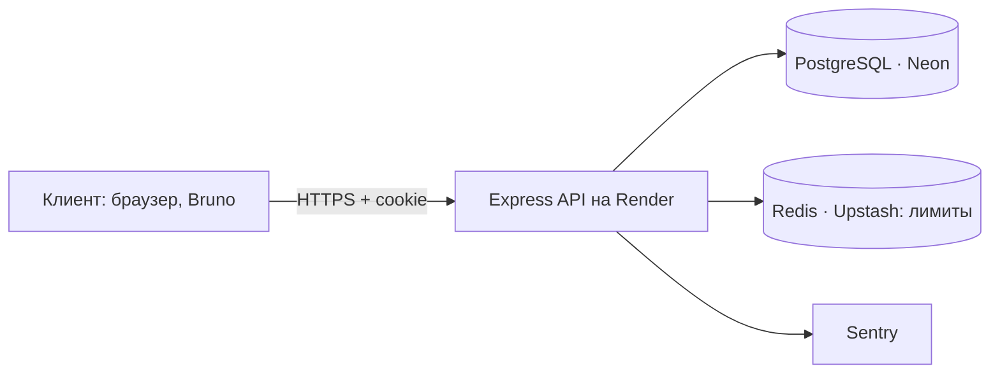
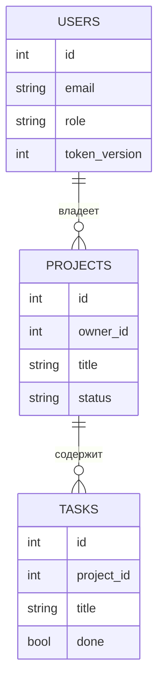

@@ 0

### На пальцах
Второй проект — офисное здание с пропускной системой. В первом проекте любой мог зайти куда угодно. Теперь у каждого есть пропуск (аккаунт), а турникеты знают, кто сотрудник, кто менеджер, а кто администратор, и пускают каждого только туда, куда положено.

### Как это работает
Минимальный набор:

| Маршрут | Что делает |
|---|---|
| `POST /api/auth/register` | регистрация: email, пароль от 8 символов, имя |
| `POST /api/auth/login` | вход: проверка пароля через bcrypt, cookie сессии |
| `POST /api/auth/logout` | выход: удалить cookie (и сессию) |
| `GET /api/me` | текущий пользователь |
| `PATCH /api/me/password` | смена пароля с проверкой старого |

Таблица `users`: `id`, `email` (уникальный, в нижнем регистре), `password_hash`, `name`, `role` (`user`, `manager`, `admin`), `token_version`, `created_at`.

Решения, которые стоит принять и описать в README:

- сессия — JWT в httpOnly-cookie с `token_version` или серверная сессия в Redis;
- ограничение неудачных входов;
- первый администратор создаётся из переменных окружения при старте, а регистрироваться под его логином нельзя;
- смена пароля увеличивает `token_version` — все старые сессии перестают работать.

### Пример
```js
// src/routes/auth.js
const credentials = z.object({
  email: z.string().trim().toLowerCase().email(),
  password: z.string().min(8).max(200),
});

authRouter.post("/register", wrap(async (req, res) => {
  const { email, password } = credentials.parse(req.body);
  const name = z.string().trim().min(2).max(60).parse(req.body.name);
  const hash = await bcrypt.hash(password, 11);
  const { rows: [user] } = await q(
    "INSERT INTO users (email, password_hash, name) VALUES ($1, $2, $3) RETURNING id, email, name, role, token_version",
    [email, hash, name]
  );
  issueSession(res, user);
  res.status(201).json(publicUser(user));
}));

authRouter.post("/login", loginLimiter, wrap(async (req, res) => {
  const { email, password } = credentials.parse(req.body);
  const { rows: [user] } = await q("SELECT * FROM users WHERE email = $1", [email]);
  if (!user || !(await bcrypt.compare(password, user.password_hash))) {
    throw new AppError(401, "Неверный email или пароль", "BAD_CREDENTIALS");
  }
  issueSession(res, user);
  res.json(publicUser(user));
}));

const publicUser = u => ({ id: u.id, email: u.email, name: u.name, role: u.role });
```

### Частые ошибки
- Возвращать в ответе `password_hash`.
- Разные сообщения «нет такого email» и «неверный пароль».
- Позволить указать `role` при регистрации в теле запроса.

### Мини-задание
Сделай регистрацию, вход, выход, `/api/me` и смену пароля с инвалидацией старых сессий. Создай администратора из переменных окружения при старте сервера.

@@ 1

### На пальцах
Права на уровне ролей — «менеджеры могут заходить в отдел продаж». Права на уровне записей — «менеджер Анна может открыть только папки своих клиентов». Вторая проверка тоньше, о ней чаще забывают, и именно через неё чаще всего утекают чужие данные.

### Как это работает
Модель для проекта:

- у проекта есть владелец `owner_id`, у задач — проект;
- **user** видит и меняет только свои проекты и их задачи;
- **manager** видит все проекты, но меняет только свои;
- **admin** может всё.

Где проверять:

1. В репозитории — фильтровать по владельцу прямо в SQL: `WHERE id = $1 AND owner_id = $2`. Чужая запись просто «не находится» → 404.
2. Для задач — проверять доступ через проект: задача принадлежит проекту, проект — пользователю.
3. Удобно вынести правило в одну функцию `canEdit(user, project)`, чтобы не дублировать.

Списки: `user` получает `WHERE owner_id = $1`, `manager` и `admin` — без фильтра.

### Пример
```js
// src/services/access.js
export function canView(user, project) {
  return user.role === "admin" || user.role === "manager" || project.owner_id === user.id;
}
export function canEdit(user, project) {
  return user.role === "admin" || project.owner_id === user.id;
}

// src/services/projects.js
export async function getProjectFor(user, id) {
  const project = await projectsRepo.findById(id);
  if (!project || !canView(user, project)) throw new AppError(404, "Проект не найден", "NOT_FOUND");
  return project;
}

export async function updateProject(user, id, data) {
  const project = await getProjectFor(user, id);
  if (!canEdit(user, project)) throw new AppError(403, "Можно менять только свои проекты", "FORBIDDEN");
  return projectsRepo.update(id, data);
}

// задачи — доступ через проект
export async function updateTask(user, taskId, data) {
  const task = await tasksRepo.findById(taskId);
  if (!task) throw new AppError(404, "Задача не найдена", "NOT_FOUND");
  await updateProject(user, task.project_id, {});   // проверит права на проект
  return tasksRepo.update(taskId, data);
}
```

### Частые ошибки
- `PATCH /api/tasks/:id` проверяет только, что пользователь вошёл, но не чей проект.
- Владелец берётся из тела запроса (`ownerId` от клиента), а не из сессии.
- Правила прав разбросаны по маршрутам с небольшими различиями.

### Мини-задание
Добавь `owner_id` в проекты и реализуй правила для трёх ролей. Напиши тест, где пользователь Б пытается прочитать, изменить и удалить проект и задачу пользователя А.

@@ 2

### На пальцах
Проект с авторизацией без тестов — дом с замками, которые никто не проверял. Однажды после безобидной правки замок перестаёт запираться, и узнаёшь об этом от взломщика. Тесты в CI — ночной обход охранника, который после каждого изменения дёргает все двери.

### Как это работает
Что покрыть тестами в первую очередь:

- регистрация: успех, занятый email (409), короткий пароль (400);
- вход: успех, неверный пароль (401), блокировка после 10 попыток (429);
- `/api/me` без сессии (401), с сессией (200), после смены пароля старая сессия не работает;
- права: чужой проект — 404, менеджер не может изменить чужой — 403, админ может всё;
- CRUD своих проектов и задач.

Инфраструктура:

- тестовая база: PostgreSQL в `services` GitHub Actions;
- перед тестами — миграции, перед каждым — очистка и минимальные данные;
- хелпер «войти как» — возвращает `supertest.agent` с cookie;
- bcrypt со стоимостью 4 в тестах — иначе тесты медленные.

### Пример
```js
// tests/helpers.js
export async function loginAs(email, password = "password123") {
  const agent = request.agent(app);
  await agent.post("/api/auth/login").send({ email, password }).expect(200);
  return agent;
}
```

```js
// tests/auth.test.js
describe("сессии", () => {
  beforeEach(resetDb);

  it("после смены пароля старая сессия перестаёт работать", async () => {
    const tab1 = await loginAs("anna@test.ru");
    const tab2 = await loginAs("anna@test.ru");
    await tab1.patch("/api/me/password").send({ oldPassword: "password123", newPassword: "newpass456" }).expect(200);
    await tab2.get("/api/me").expect(401);
  });

  it("ограничивает перебор паролей", async () => {
    for (let i = 0; i < 10; i++) {
      await request(app).post("/api/auth/login").send({ email: "anna@test.ru", password: "wrong" });
    }
    await request(app).post("/api/auth/login").send({ email: "anna@test.ru", password: "wrong" }).expect(429);
  });
});
```

### Частые ошибки
- Тестировать только «счастливый путь» входа.
- Тесты с bcrypt стоимостью 11 — прогон длится минуты.
- Лимитер входов, который «помнит» попытки между тестами, — сбрасывай его состояние в `resetDb`.

### Мини-задание
Напиши тесты из списка выше и настрой их запуск в GitHub Actions с PostgreSQL. Добейся зелёного прогона и включи защиту ветки `main`.

@@ 3

### На пальцах
Docker Compose для проекта — коробка «собери сам» с инструкцией на одну строку. Проверяющему не нужно ставить PostgreSQL, Redis и нужную версию Node.js: `docker compose up` — и весь проект работает на его компьютере точно так же, как у тебя.

### Как это работает
Что описать в `compose.yaml`:

- `db` — PostgreSQL с томом и healthcheck;
- `redis` — если используются сессии, лимиты или очереди;
- `api` — сборка из Dockerfile, переменные окружения, зависимость от готовности базы;
- при необходимости `worker` — тот же образ, другая команда.

Удобства:

- команда миграций и seed при старте (отдельный одноразовый сервис или `command`);
- проброс порта API наружу;
- `.env.example` с переменными для Compose.

В README — раздел «Запуск через Docker» из трёх команд.

### Пример
```yaml
# compose.yaml
services:
  db:
    image: postgres:16-alpine
    environment: { POSTGRES_PASSWORD: secret, POSTGRES_DB: tasks }
    volumes: [pgdata:/var/lib/postgresql/data]
    healthcheck:
      test: ["CMD-SHELL", "pg_isready -U postgres"]
      interval: 3s
      retries: 10

  redis:
    image: redis:7-alpine

  migrate:
    build: .
    command: ["sh", "-c", "node scripts/migrate.js && node scripts/seed.js"]
    environment: &env
      DATABASE_URL: postgres://postgres:secret@db:5432/tasks
      REDIS_URL: redis://redis:6379
      JWT_SECRET: compose-local-secret-0123456789abcdef
      ADMIN_EMAIL: admin@local.test
      ADMIN_PASSWORD: adminpass123
    depends_on:
      db: { condition: service_healthy }

  api:
    build: .
    ports: ["3000:3000"]
    environment: *env
    depends_on:
      migrate: { condition: service_completed_successfully }
      redis: { condition: service_started }

volumes:
  pgdata:
```

```bash
docker compose up --build
curl localhost:3000/api/health
```

### Частые ошибки
- Боевые секреты в `compose.yaml` в репозитории (для локального запуска — только тестовые значения).
- API стартует раньше миграций и падает на отсутствующих таблицах.
- Забыть про том для базы — данные пропадают при каждом `down`.

### Мини-задание
Опиши свой проект в Compose с миграциями и seed при старте. Попроси знакомого (или проверь на чистой папке) запустить проект только по инструкции из README.

@@ 4

### На пальцах
Запустить проект — половина дела. Вторая половина — знать, что он жив и здоров, и узнавать о проблемах раньше пользователей. Деплой с мониторингом — машина на дороге не только с двигателем, но и с приборной панелью и сигнализацией.

### Как это работает
Деплой:

- API — Render (или Railway, Fly.io), база — Neon, Redis — Upstash;
- переменные окружения на хостинге, отдельные секреты для продакшена;
- миграции при деплое: команда перед стартом (`preDeployCommand` в Render или в `startCommand`: `node scripts/migrate.js && node src/index.js`);
- health-check `/healthz` в настройках сервиса;
- автодеплой из `main` после зелёного CI.

Мониторинг:

- логи в панели хостинга (структурированные через pino);
- Sentry для необработанных ошибок;
- внешняя проверка доступности (UptimeRobot) раз в 5 минут с уведомлением.

Что проверить после деплоя (смоук-тест): регистрация, вход, создание проекта, доступ к чужому — 404, выход.

### Пример
```yaml
# render.yaml
services:
  - type: web
    name: tasks-api
    runtime: node
    region: frankfurt
    plan: free
    buildCommand: npm ci --omit=dev
    preDeployCommand: node scripts/migrate.js
    startCommand: node src/index.js
    healthCheckPath: /healthz
    envVars:
      - key: NODE_ENV
        value: production
      - key: DATABASE_URL
        sync: false
      - key: REDIS_URL
        sync: false
      - key: JWT_SECRET
        generateValue: true
      - key: SENTRY_DSN
        sync: false
```

```bash
# смоук-тест после деплоя
API=https://tasks-api-anna.onrender.com
curl -fsS $API/healthz
curl -fsS -c jar.txt -X POST $API/api/auth/login -H "Content-Type: application/json" -d '{"email":"demo@demo.ru","password":"demo12345"}'
curl -fsS -b jar.txt $API/api/me
```

### Частые ошибки
- Миграции «руками когда-нибудь» — новая версия кода падает на старой схеме.
- Нет демо-аккаунта — проверяющему нечем войти.
- Нет мониторинга — проект «умер» месяц назад, а ссылка в резюме.

### Мини-задание
Задеплой проект с автоматическими миграциями и health-check, подключи Sentry и UptimeRobot. Создай демо-аккаунт и укажи его данные в README.

@@ 5

### На пальцах
Описание архитектуры — экскурсия для работодателя: «вот здесь заходят запросы, здесь проверяются права, здесь лежат данные, а вот почему сделано именно так». Код показывает, что ты умеешь писать. Архитектура в README показывает, что ты умеешь думать.

### Как это работает
Что включить в раздел «Архитектура»:

1. **Схема компонентов** — Mermaid-диаграмма: клиент → API → PostgreSQL, Redis, внешние сервисы.
2. **Слои** — маршруты, сервисы, репозитории: кто за что отвечает.
3. **Модель данных** — таблицы и связи (ER-диаграмма Mermaid).
4. **Авторизация** — как устроена сессия, какие роли, как проверяются права на записи.
5. **Ключевые решения** — почему JWT в cookie, а не в localStorage; почему Neon; почему проверки в SQL.
6. **Что улучшить** — честный список: очереди для писем, пагинация курсором, аудит действий.

GitHub рисует диаграммы Mermaid прямо в README, если блок кода помечен словом mermaid.

### Пример
Схема компонентов:



Модель данных:



Ключевые решения — пример формулировок:

```markdown
- **JWT в httpOnly-cookie + token_version** — токен недоступен скриптам на странице,
  смена пароля мгновенно разлогинивает все устройства.
- **Проверка владельца прямо в SQL** (`WHERE id = $1 AND owner_id = $2`) — чужая запись
  не может «утечь» из-за забытой проверки в коде.
- **Слои routes → services → repositories** — бизнес-правила покрыты unit-тестами без базы.
```

### Частые ошибки
- Схема, которая не совпадает с кодом.
- Решения без «почему».
- Нет раздела «что улучшить» — кажется, что ты не видишь слабых мест.

### Мини-задание
Добавь в README своего проекта раздел «Архитектура» с двумя диаграммами Mermaid, описанием авторизации и тремя решениями с объяснением. Проверь, что диаграммы отображаются на GitHub.
