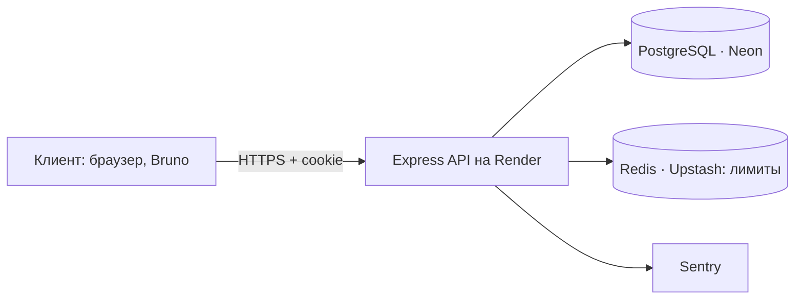
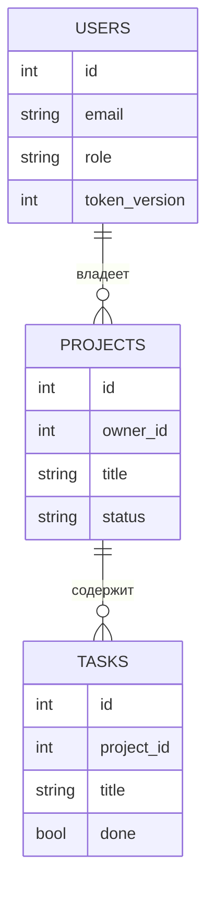

@@ 0

### Ситуация
Первый проект работает, но любой, кто знает адрес, может удалить все проекты одним запросом `DELETE`. Для учебного API сойдёт, для настоящего — нет. Работодатели почти всегда спрашивают про авторизацию: как хранишь пароли, как устроена сессия, что будет при смене пароля. Второй проект отвечает на эти вопросы кодом.

### На пальцах
Второй проект — офисное здание с пропускной системой. В первом проекте любой мог зайти куда угодно. Теперь у каждого есть пропуск (аккаунт), а турникеты знают, кто сотрудник, кто менеджер, а кто администратор, и пускают каждого только туда, куда положено.

### Как это работает
Минимальный набор:

| Маршрут | Что делает |
|---|---|
| `POST /api/auth/register` | регистрация: email, пароль от 8 символов, имя |
| `POST /api/auth/login` | вход: проверка пароля через bcrypt, cookie сессии |
| `POST /api/auth/logout` | выход: удалить cookie (и сессию) |
| `GET /api/me` | текущий пользователь |
| `PATCH /api/me/password` | смена пароля с проверкой старого |

Таблица `users`: `id`, `email` (уникальный, в нижнем регистре), `password_hash`, `name`, `role` (`user`, `manager`, `admin`), `token_version`, `created_at`.

Решения, которые стоит принять и описать в README:

- сессия — JWT в httpOnly-cookie с `token_version` (так устроен вход и на этой платформе) или серверная сессия в Redis;
- ограничение неудачных входов;
- первый администратор создаётся из переменных окружения при старте, а регистрироваться под его логином нельзя;
- смена пароля увеличивает `token_version` — все старые сессии перестают работать.

?: Почему на неверный email и неверный пароль отвечают одним и тем же сообщением? || Разные сообщения позволяют перебором узнать, какие email зарегистрированы, а потом подбирать пароли только к ним. Одинаковое «Неверный email или пароль» не выдаёт, что именно не так.

### Пример
```js
// src/routes/auth.js
const credentials = z.object({
  email: z.string().trim().toLowerCase().email(),
  password: z.string().min(8).max(200),
});

authRouter.post("/register", wrap(async (req, res) => {
  const { email, password } = credentials.parse(req.body);
  const name = z.string().trim().min(2).max(60).parse(req.body.name);
  const hash = await bcrypt.hash(password, 11);
  const { rows: [user] } = await q(
    "INSERT INTO users (email, password_hash, name) VALUES ($1, $2, $3) RETURNING id, email, name, role, token_version",
    [email, hash, name]
  );
  issueSession(res, user);
  res.status(201).json(publicUser(user));
}));

authRouter.post("/login", loginLimiter, wrap(async (req, res) => {
  const { email, password } = credentials.parse(req.body);
  const { rows: [user] } = await q("SELECT * FROM users WHERE email = $1", [email]);
  if (!user || !(await bcrypt.compare(password, user.password_hash))) {
    throw new AppError(401, "Неверный email или пароль", "BAD_CREDENTIALS");
  }
  issueSession(res, user);
  res.json(publicUser(user));
}));

const publicUser = u => ({ id: u.id, email: u.email, name: u.name, role: u.role });
```

?! Кто-то регистрируется с телом `{ "email": " Anna@Mail.RU ", "password": "password123", "name": "Анна", "role": "admin" }`. Какой email запишется в базу и какая будет роль? А если `anna@mail.ru` уже занят? || Email — `anna@mail.ru`: `trim` и `toLowerCase`. Роль — `user` по умолчанию из таблицы: `role` из тела никуда не передаётся. Если email занят, PostgreSQL бросит ошибку `23505`, и обработчик ошибок вернёт 409 `CONFLICT`.

### Частые ошибки
- **Возвращать в ответе `password_hash`.**
- **Разные сообщения** «нет такого email» и «неверный пароль».
- **Позволить указать `role` при регистрации** в теле запроса.

### Проверь себя
?? Какие поля нужны в таблице `users` для этого проекта? || `id`, `email` (уникальный), `password_hash`, `name`, `role`, `token_version`, `created_at`.
?? Зачем функция `publicUser`? || Отдавать клиенту только безопасные поля и никогда не вернуть хеш пароля или служебные данные.
?? Объясни своими словами, как `token_version` разлогинивает все устройства. || Номер версии записан и в токене, и в базе. При смене пароля номер в базе увеличивается, и все токены со старым номером при проверке отклоняются.

### Мини-задание
Сделай регистрацию, вход, выход, `/api/me` и смену пароля с инвалидацией старых сессий. Создай администратора из переменных окружения при старте сервера.

@@ 1

### Ситуация
Вход работает: без сессии — 401. Анна вошла и открыла свой проект 12. Из любопытства она меняет в адресе 12 на 13 — и видит проект другого клиента с бюджетом и контактами. Проверка «вошёл ли пользователь» есть, проверки «его ли это запись» — нет. Это самая частая уязвимость API.

### На пальцах
Права на уровне ролей — «менеджеры могут заходить в отдел продаж». Права на уровне записей — «менеджер Анна может открыть только папки своих клиентов». Вторая проверка тоньше, о ней чаще забывают, и именно через неё чаще всего утекают чужие данные.

### Как это работает
Модель для проекта:

- у проекта есть владелец `owner_id`, у задач — проект;
- **user** видит и меняет только свои проекты и их задачи;
- **manager** видит все проекты, но меняет только свои;
- **admin** может всё.

Где проверять:

1. В репозитории — фильтровать по владельцу прямо в SQL: `WHERE id = $1 AND owner_id = $2`. Чужая запись просто «не находится» → 404.
2. Для задач — проверять доступ через проект: задача принадлежит проекту, проект — пользователю.
3. Удобно вынести правило в одну функцию `canEdit(user, project)`, чтобы не дублировать.

Списки: `user` получает `WHERE owner_id = $1`, `manager` и `admin` — без фильтра.

?: Почему владельца берут из сессии, а не из тела запроса? || Тело запроса пишет клиент, и он может подставить чужой `ownerId`. Сессию подписал сервер, подделать её нельзя. Всё, что касается «кто я», доверяют только сессии.

### Пример
```js
// src/services/access.js
export function canView(user, project) {
  return user.role === "admin" || user.role === "manager" || project.owner_id === user.id;
}
export function canEdit(user, project) {
  return user.role === "admin" || project.owner_id === user.id;
}

// src/services/projects.js
export async function getProjectFor(user, id) {
  const project = await projectsRepo.findById(id);
  if (!project || !canView(user, project)) throw new AppError(404, "Проект не найден", "NOT_FOUND");
  return project;
}

export async function updateProject(user, id, data) {
  const project = await getProjectFor(user, id);
  if (!canEdit(user, project)) throw new AppError(403, "Можно менять только свои проекты", "FORBIDDEN");
  return projectsRepo.update(id, data);
}

// задачи — доступ через проект
export async function updateTask(user, taskId, data) {
  const task = await tasksRepo.findById(taskId);
  if (!task) throw new AppError(404, "Задача не найдена", "NOT_FOUND");
  await updateProject(user, task.project_id, {});
  return tasksRepo.update(taskId, data);
}
```

?! Проект 13 принадлежит Борису. Что получат при попытке изменить его: обычный пользователь Анна, менеджер Вера и администратор? || Анна — 404: `canView` для неё ложно, проект «не найден». Вера — 403: видеть ей можно, а менять — нет. Администратор — успешное обновление.

### Частые ошибки
- **`PATCH /api/tasks/:id` проверяет только вход**, но не чей проект.
- **Владелец берётся из тела запроса** (`ownerId` от клиента), а не из сессии.
- **Правила прав разбросаны по маршрутам** с небольшими различиями.

### Проверь себя
?? Чем права на уровне ролей отличаются от прав на уровне записей? || Роль определяет, какие действия вообще разрешены. Права на запись — можно ли этому пользователю работать с конкретным объектом.
?? Как проверить доступ к задаче? || Через её проект: найти задачу, затем проверить права пользователя на `task.project_id`.
?? Объясни своими словами, зачем выносить правила в `canView` и `canEdit`. || Правило живёт в одном месте: его легко протестировать и изменить, и нет риска, что в одном маршруте проверка строже, а в другом её забыли.

### Мини-задание
Добавь `owner_id` в проекты и реализуй правила для трёх ролей. Напиши тест, где пользователь Б пытается прочитать, изменить и удалить проект и задачу пользователя А.

@@ 2

### Ситуация
Ты отрефакторил middleware авторизации, вынес повторяющийся код — стало красивее. Проверил вход в браузере — работает. Только смена пароля перестала разлогинивать другие устройства: ты случайно убрал сравнение `token_version`. Заметить это вручную почти невозможно. Тест заметил бы за секунду.

### На пальцах
Проект с авторизацией без тестов — дом с замками, которые никто не проверял. Однажды после безобидной правки замок перестаёт запираться, и узнаёшь об этом от взломщика. Тесты в CI — ночной обход охранника, который после каждого изменения дёргает все двери.

### Как это работает
Что покрыть тестами в первую очередь:

- регистрация: успех, занятый email (409), короткий пароль (400);
- вход: успех, неверный пароль (401), блокировка после 10 попыток (429);
- `/api/me` без сессии (401), с сессией (200), после смены пароля старая сессия не работает;
- права: чужой проект — 404, менеджер не может изменить чужой — 403, админ может всё;
- CRUD своих проектов и задач.

Инфраструктура:

- тестовая база: PostgreSQL в `services` GitHub Actions;
- перед тестами — миграции, перед каждым — очистка и минимальные данные;
- хелпер «войти как» — возвращает `supertest.agent` с cookie;
- bcrypt со стоимостью 4 в тестах — иначе тесты медленные.

?: Почему защитные функции (выход, права, лимиты) особенно важно покрывать тестами? || Их поломка не видна при обычной работе: всё по-прежнему «работает», просто стало можно то, что было нельзя. Пользователь о такой ошибке не сообщит, её обнаружит атакующий. Тест — единственный, кто регулярно проверяет, что «нельзя» всё ещё нельзя.

### Пример
```js
// tests/helpers.js
export async function loginAs(email, password = "password123") {
  const agent = request.agent(app);
  await agent.post("/api/auth/login").send({ email, password }).expect(200);
  return agent;
}
```

```js
// tests/auth.test.js
describe("сессии", () => {
  beforeEach(resetDb);

  it("после смены пароля старая сессия перестаёт работать", async () => {
    const tab1 = await loginAs("anna@test.ru");
    const tab2 = await loginAs("anna@test.ru");
    await tab1.patch("/api/me/password").send({ oldPassword: "password123", newPassword: "newpass456" }).expect(200);
    await tab2.get("/api/me").expect(401);
  });

  it("ограничивает перебор паролей", async () => {
    for (let i = 0; i < 10; i++) {
      await request(app).post("/api/auth/login").send({ email: "anna@test.ru", password: "wrong" });
    }
    await request(app).post("/api/auth/login").send({ email: "anna@test.ru", password: "wrong" }).expect(429);
  });
});
```

?! Тесты запускаются в таком порядке: сначала «ограничивает перебор», потом «после смены пароля». Лимитер хранит попытки в памяти и не сбрасывается в `resetDb`. Что случится со вторым тестом? || Первый тест уже исчерпал лимит, поэтому `loginAs` во втором тесте получит 429 вместо 200 и упадёт на `.expect(200)`. Тест сломан не из-за кода смены пароля, а из-за общего состояния — поэтому лимитер сбрасывают перед каждым тестом.

### Частые ошибки
- **Тестировать только «счастливый путь» входа.**
- **Тесты с bcrypt стоимостью 11** — прогон длится минуты.
- **Лимитер входов, который «помнит» попытки между тестами**, — сбрасывай его состояние в `resetDb`.

### Проверь себя
?? Какие тесты на сессии нужны в первую очередь? || `/api/me` без сессии — 401, с сессией — 200, после смены пароля старая сессия — 401.
?? Зачем хелпер `loginAs`? || Одной строкой получить агента с cookie нужного пользователя, чтобы не повторять вход в каждом тесте.
?? Объясни своими словами, почему тесты не должны зависеть друг от друга. || Тогда результат одного теста не зависит от порядка запуска и от того, что оставили другие; падение указывает на настоящую проблему, а не на случайное общее состояние.

### Мини-задание
Напиши тесты из списка выше и настрой их запуск в GitHub Actions с PostgreSQL. Добейся зелёного прогона и включи защиту ветки `main`.

@@ 3

### Ситуация
Проверяющий хочет запустить твой проект у себя. Для этого нужны PostgreSQL 16, Redis, Node 22, создать базу, применить миграции, заполнить данные. У него Windows и PostgreSQL 13 от другого проекта. Через полчаса он сдаётся. Docker Compose сворачивает всю эту подготовку в одну команду.

### На пальцах
Docker Compose для проекта — коробка «собери сам» с инструкцией на одну строку. Проверяющему не нужно ставить PostgreSQL, Redis и нужную версию Node.js: `docker compose up` — и весь проект работает на его компьютере точно так же, как у тебя.

### Как это работает
Что описать в `compose.yaml`:

- `db` — PostgreSQL с томом и healthcheck;
- `redis` — если используются сессии, лимиты или очереди;
- `api` — сборка из Dockerfile, переменные окружения, зависимость от готовности базы;
- при необходимости `worker` — тот же образ, другая команда.

Удобства:

- команда миграций и seed при старте (отдельный одноразовый сервис или `command`);
- проброс порта API наружу;
- `.env.example` с переменными для Compose.

В README — раздел «Запуск через Docker» из трёх команд.

?: Зачем healthcheck у базы, если есть `depends_on`? || Простой `depends_on` ждёт только запуска контейнера, а PostgreSQL ещё несколько секунд готовится принимать соединения. С `condition: service_healthy` Compose ждёт, пока `pg_isready` ответит «готов», и миграции не падают на «connection refused».

### Пример
```yaml
# compose.yaml
services:
  db:
    image: postgres:16-alpine
    environment: { POSTGRES_PASSWORD: secret, POSTGRES_DB: tasks }
    volumes: [pgdata:/var/lib/postgresql/data]
    healthcheck:
      test: ["CMD-SHELL", "pg_isready -U postgres"]
      interval: 3s
      retries: 10

  redis:
    image: redis:7-alpine

  migrate:
    build: .
    command: ["sh", "-c", "node scripts/migrate.js && node scripts/seed.js"]
    environment: &env
      DATABASE_URL: postgres://postgres:secret@db:5432/tasks
      REDIS_URL: redis://redis:6379
      JWT_SECRET: compose-local-secret-0123456789abcdef
      ADMIN_EMAIL: admin@local.test
      ADMIN_PASSWORD: adminpass123
    depends_on:
      db: { condition: service_healthy }

  api:
    build: .
    ports: ["3000:3000"]
    environment: *env
    depends_on:
      migrate: { condition: service_completed_successfully }
      redis: { condition: service_started }

volumes:
  pgdata:
```

```bash
docker compose up --build
curl localhost:3000/api/health
```

?! В каком порядке запустятся сервисы после `docker compose up`? Что будет с `api`, если в миграции окажется синтаксическая ошибка? || `db` и `redis` → когда база здорова, `migrate` → когда `migrate` успешно завершился, `api`. При ошибке в миграции `migrate` завершится с ошибкой, условие `service_completed_successfully` не выполнится, и `api` не запустится вовсе.

### Частые ошибки
- **Боевые секреты в `compose.yaml`** в репозитории (для локального запуска — только тестовые значения).
- **API стартует раньше миграций** и падает на отсутствующих таблицах.
- **Забыть про том для базы** — данные пропадают при пересоздании контейнера.

### Проверь себя
?? Почему в `DATABASE_URL` хост — `db`, а не `localhost`? || Внутри сети Compose сервисы находят друг друга по именам; `localhost` в контейнере `api` — это сам контейнер.
?? Что делают `&env` и `*env` в YAML? || `&env` даёт имя блоку переменных, `*env` вставляет тот же блок в другом месте, чтобы не дублировать.
?? Объясни своими словами, зачем отдельный сервис `migrate`. || Он один раз готовит базу (миграции и seed) и завершается, а API стартует только после его успеха — так API никогда не работает со старой или пустой схемой.

### Мини-задание
Опиши свой проект в Compose с миграциями и seed при старте. Попроси знакомого (или проверь на чистой папке) запустить проект только по инструкции из README.

@@ 4

### Ситуация
Ссылка на API в резюме ведёт на страницу с ошибкой 502. Ты не знал: месяц назад ты сменил пароль базы в Neon и забыл обновить `DATABASE_URL` на Render, и приложение с тех пор падает при старте. Рекрутер открыл ссылку, увидел ошибку и закрыл вкладку. Задеплоить мало — нужно узнавать о поломке раньше всех.

### На пальцах
Запустить проект — половина дела. Вторая половина — знать, что он жив и здоров, и узнавать о проблемах раньше пользователей. Деплой с мониторингом — машина на дороге не только с двигателем, но и с приборной панелью и сигнализацией.

### Как это работает
Деплой:

- API — Render (или Railway, Fly.io), база — Neon, Redis — Upstash;
- переменные окружения на хостинге, отдельные секреты для продакшена;
- миграции при деплое: команда перед стартом (`preDeployCommand` в Render или в `startCommand`: `node scripts/migrate.js && node src/index.js`);
- health-check `/healthz` в настройках сервиса;
- автодеплой из `main` после зелёного CI.

Мониторинг:

- логи в панели хостинга (структурированные через pino);
- Sentry для необработанных ошибок;
- внешняя проверка доступности (UptimeRobot) раз в 5 минут с уведомлением.

Что проверить после деплоя (смоук-тест): регистрация, вход, создание проекта, доступ к чужому — 404, выход.

?: Почему миграции запускают перед стартом новой версии, а не «руками, когда вспомню»? || Новый код рассчитан на новую схему: если в нём есть запрос к новой колонке, а миграцию не применили, он упадёт на первом же запросе. Автоматический запуск перед стартом гарантирует, что код и схема всегда совпадают.

### Пример
```yaml
# render.yaml
services:
  - type: web
    name: tasks-api
    runtime: node
    region: frankfurt
    plan: free
    buildCommand: npm ci --omit=dev
    preDeployCommand: node scripts/migrate.js
    startCommand: node src/index.js
    healthCheckPath: /healthz
    envVars:
      - key: NODE_ENV
        value: production
      - key: DATABASE_URL
        sync: false
      - key: REDIS_URL
        sync: false
      - key: JWT_SECRET
        generateValue: true
      - key: SENTRY_DSN
        sync: false
```

```bash
# смоук-тест после деплоя
API=https://tasks-api-anna.onrender.com
curl -fsS $API/healthz
curl -fsS -c jar.txt -X POST $API/api/auth/login -H "Content-Type: application/json" -d '{"email":"demo@demo.ru","password":"demo12345"}'
curl -fsS -b jar.txt $API/api/me
```

?! В смоук-тесте вход вернул 401, потому что демо-аккаунта нет. Что произойдёт дальше благодаря флагу `-f`, и что вернёт `/api/me`, если запустить его вручную? || С `-f` curl считает ответ 4xx/5xx ошибкой и завершается с ненулевым кодом — в скрипте или CI это сразу видно как провал. `/api/me` вернёт 401: в `jar.txt` нет cookie сессии.

### Частые ошибки
- **Миграции «руками когда-нибудь»** — новая версия кода падает на старой схеме.
- **Нет демо-аккаунта** — проверяющему нечем войти.
- **Нет мониторинга** — проект «умер» месяц назад, а ссылка в резюме.

### Проверь себя
?? Зачем сервису health-check? || Хостинг проверяет его перед тем, как пустить трафик на новую версию, и перезапускает сервис, если тот перестал отвечать.
?? Какие три инструмента мониторинга подходят для учебного проекта? || Логи хостинга, Sentry для ошибок, UptimeRobot для проверки доступности.
?? Объясни своими словами, что такое смоук-тест. || Быстрая проверка главных сценариев сразу после деплоя: жив ли сервис, работает ли вход, создаются ли данные. Если «дымит» — откатываемся, не дожидаясь жалоб.

### Мини-задание
Задеплой проект с автоматическими миграциями и health-check, подключи Sentry и UptimeRobot. Создай демо-аккаунт и укажи его данные в README.

@@ 5

### Ситуация
На собеседовании тимлид открывает твой проект и спрашивает: «Почему JWT, а не сессии в Redis? Где проверяются права? Что будет, если таблица задач вырастет до миллиона строк?» Если ответы приходится вспоминать на ходу — разговор не складывается. Если они уже записаны в README — ты показываешь, что думал заранее.

### На пальцах
Описание архитектуры — экскурсия для работодателя: «вот здесь заходят запросы, здесь проверяются права, здесь лежат данные, а вот почему сделано именно так». Код показывает, что ты умеешь писать. Архитектура в README показывает, что ты умеешь думать.

### Как это работает
Что включить в раздел «Архитектура»:

1. **Схема компонентов** — Mermaid-диаграмма: клиент → API → PostgreSQL, Redis, внешние сервисы.
2. **Слои** — маршруты, сервисы, репозитории: кто за что отвечает.
3. **Модель данных** — таблицы и связи (ER-диаграмма Mermaid).
4. **Авторизация** — как устроена сессия, какие роли, как проверяются права на записи.
5. **Ключевые решения** — почему JWT в cookie, а не в localStorage; почему Neon; почему проверки в SQL.
6. **Что улучшить** — честный список: очереди для писем, пагинация курсором, аудит действий.

GitHub рисует диаграммы Mermaid прямо в README, если блок кода помечен словом mermaid.

?: Почему решение без «почему» почти ничего не стоит в README? || «Используется JWT» видно и из кода. Ценность — в причине и цене выбора: что получили, от чего отказались. Это показывает, что ты сравнивал варианты, а не взял первый попавшийся из туториала.

### Пример
Схема компонентов:



Модель данных:



Ключевые решения — пример формулировок:

```markdown
- **JWT в httpOnly-cookie + token_version** — токен недоступен скриптам на странице,
  смена пароля мгновенно разлогинивает все устройства.
- **Проверка владельца прямо в SQL** (`WHERE id = $1 AND owner_id = $2`) — чужая запись
  не может «утечь» из-за забытой проверки в коде.
- **Слои routes → services → repositories** — бизнес-правила покрыты unit-тестами без базы.
```

?! Прочитай ER-диаграмму: может ли у одного пользователя быть ноль проектов? Может ли задача существовать без проекта? || Ноль проектов — может: `o{` означает «ноль или много». Задача без проекта — нет: `||` со стороны проекта значит «ровно один», и в таблице это `project_id NOT NULL REFERENCES projects`.

### Частые ошибки
- **Схема, которая не совпадает с кодом.**
- **Решения без «почему».**
- **Нет раздела «что улучшить»** — кажется, что ты не видишь слабых мест.

### Проверь себя
?? Какие шесть частей входят в раздел «Архитектура»? || Схема компонентов, слои, модель данных, авторизация, ключевые решения и что улучшить.
?? Как сделать, чтобы диаграмма отображалась на GitHub? || Написать её в блоке кода с пометкой `mermaid` — GitHub нарисует её сам.
?? Объясни своими словами, что даёт работодателю раздел «Архитектура». || Он за пару минут видит, как устроен проект и почему, и понимает, что ты умеешь принимать и объяснять инженерные решения, а не только писать код.

### Мини-задание
Добавь в README своего проекта раздел «Архитектура» с двумя диаграммами Mermaid, описанием авторизации и тремя решениями с объяснением. Проверь, что диаграммы отображаются на GitHub.
