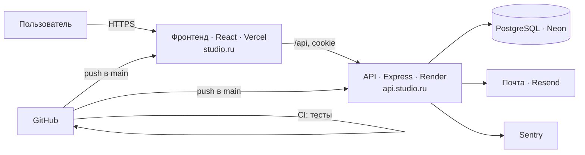

@@ 0

### На пальцах
Фронтенд финального проекта — приёмная, через которую клиент общается со всей компанией. Он не должен знать, как устроен склад, но обязан вежливо принять заявку, проверить, что бланк заполнен, сказать «подождите», если обработка идёт, и честно сообщить, если что-то не получилось.

### Как это работает
Выбор:

- **React + Vite** — если бэкенд отдельный (Express) и нужен чистый SPA;
- **Next.js** — если хочешь SEO для публичных страниц, серверные компоненты и, возможно, часть API в одном проекте.

Что должно быть во фронтенде личного кабинета:

1. **Маршруты**: вход и регистрация, список сущностей (проекты, заявки), страница одной сущности, профиль, 404.
2. **Защищённые страницы** — гостя отправляет на вход и возвращает обратно после входа.
3. **Формы** — react-hook-form + zod, ошибки полей с сервера показываются у полей, кнопка блокируется на время отправки.
4. **Данные** — TanStack Query (или серверные компоненты Next.js): кеш, повторы, обновление после изменений.
5. **Состояния** — загрузка (скелетоны), ошибка с кнопкой «Повторить», пустой список с призывом к действию.
6. **Адаптив и доступность** — от 320px, клавиатура, `label`, контраст.

План по шагам: макет экранов на бумаге → маршруты и пустые страницы → клиент API → вход → список → создание → редактирование → полировка.

### Пример
```text
Экраны личного кабинета клиента студии

/login, /register          — вход и регистрация
/projects                  — мои проекты: статус, прогресс, срок; фильтр по статусу
/projects/:id              — проект: этапы, комментарии, файлы, оплаты
/projects/new              — заявка на новый проект (форма брифа)
/account                   — профиль, смена пароля
/admin (роль admin)        — все проекты, смена статусов
```

```tsx
// маршруты (React Router)
const router = createBrowserRouter([
  { path: "/login", element: <Login /> },
  { path: "/register", element: <Register /> },
  {
    element: <RequireAuth />,
    children: [{
      element: <AppLayout />,
      children: [
        { path: "/projects", element: <Projects /> },
        { path: "/projects/new", element: <NewProject /> },
        { path: "/projects/:id", element: <ProjectPage /> },
        { path: "/account", element: <Account /> },
      ],
    }],
  },
  { path: "*", element: <NotFound /> },
]);
```

### Частые ошибки
- Начинать с дизайна и анимаций, а не с работающих экранов.
- Нет обработки ошибок и пустых состояний.
- Логика запросов внутри компонентов вместо клиента API и хуков.

### Мини-задание
Нарисуй на бумаге или в Figma все экраны своего финального проекта и схему переходов между ними. Создай проект, маршруты и пустые страницы-заглушки, задеплой — и дальше наполняй по одному экрану.

@@ 1

### На пальцах
Бэкенд финального проекта — склад и бухгалтерия в одном. Он принимает только правильно оформленные документы (валидация), выдаёт каждому только его папки (права) и ведёт честный учёт (база с ограничениями). Даже если приёмная (фронтенд) ошиблась — склад не выдаст чужого и не примет мусор.

### Как это работает
Что должно быть:

1. **API** — REST-маршруты для всех экранов фронтенда: CRUD основных сущностей, фильтры и пагинация для списков.
2. **Валидация** — zod-схемы для каждого входа, общие с фронтендом.
3. **Аутентификация** — регистрация, вход, выход, сессия в httpOnly-cookie, смена пароля.
4. **Права** — роли и проверка владельца в каждом маршруте, чтение и изменение чужого невозможно.
5. **Ошибки** — единый формат, правильные коды, никаких подробностей наружу.
6. **Безопасность** — bcrypt, ограничение попыток входа, helmet, CORS по белому списку, параметризованные запросы.
7. **Конфигурация** — проверка переменных окружения при старте.

Порядок: схема данных → миграции → аутентификация → основные сущности → права → ошибки → тесты.

### Пример
```text
Маршруты кабинета клиента студии

POST   /api/auth/register | login | logout
GET    /api/me                       PATCH /api/me/password
GET    /api/projects?status=&page=   POST  /api/projects            (бриф → проект «new»)
GET    /api/projects/:id             PATCH /api/projects/:id        (клиент — только описание)
GET    /api/projects/:id/comments    POST  /api/projects/:id/comments
PATCH  /api/admin/projects/:id/status                               (только admin)
```

```js
// правило доступа в одном месте
export function canSeeProject(user, project) {
  return user.role === "admin" || project.client_id === user.id;
}
export function canChangeStatus(user) {
  return user.role === "admin";
}
```

### Частые ошибки
- Маршрут изменения статуса доступен клиенту, потому что «кнопки же нет».
- Валидация только на фронтенде.
- `SELECT *` из таблицы пользователей в ответе — с хешем пароля.

### Мини-задание
Распиши все маршруты своего финального проекта в таблице: метод, путь, кто имеет доступ, какие ошибки возможны. Реализуй аутентификацию и первую сущность с полной проверкой прав.

@@ 2

### На пальцах
База — фундамент проекта. Ошибки в фундаменте исправлять дороже всего: стены уже стоят. Поэтому схему продумывают заранее, а меняют только через миграции — записанные шаги ремонта, которые одинаково применяются на всех копиях дома.

### Как это работает
1. **Сущности и связи** — нарисуй ER-диаграмму: пользователи, проекты, комментарии, оплаты; где один-ко-многим, где многие-ко-многим.
2. **Ограничения** — `NOT NULL`, `UNIQUE`, `CHECK` для статусов, внешние ключи с осознанным `ON DELETE`.
3. **Индексы** — на все внешние ключи и колонки частых фильтров.
4. **Миграции** — через инструмент ORM (Prisma Migrate, drizzle-kit) или свой скрипт; лежат в репозитории; применяются автоматически при деплое.
5. **Seed** — демо-данные: админ, пара клиентов, проекты в разных статусах.
6. **Окружения** — в Neon отдельные ветки для разработки, тестов и продакшена.

### Пример
```prisma
model User {
  id           Int       @id @default(autoincrement())
  email        String    @unique
  passwordHash String
  name         String
  role         Role      @default(CLIENT)
  tokenVersion Int       @default(0)
  projects     Project[]
  comments     Comment[]
  createdAt    DateTime  @default(now())
}

enum Role { CLIENT ADMIN }
enum Status { NEW IN_PROGRESS REVIEW DONE }

model Project {
  id        Int       @id @default(autoincrement())
  title     String
  brief     String
  status    Status    @default(NEW)
  budget    Int?
  client    User      @relation(fields: [clientId], references: [id], onDelete: Restrict)
  clientId  Int
  comments  Comment[]
  createdAt DateTime  @default(now())
  @@index([clientId, status])
}

model Comment {
  id        Int      @id @default(autoincrement())
  text      String
  project   Project  @relation(fields: [projectId], references: [id], onDelete: Cascade)
  projectId Int
  author    User     @relation(fields: [authorId], references: [id])
  authorId  Int
  createdAt DateTime @default(now())
  @@index([projectId])
}
```

```bash
npx prisma migrate dev --name init      # локально: создать и применить миграцию
npx prisma migrate deploy               # на сервере: применить новые миграции
npx prisma db seed                      # демо-данные
```

### Частые ошибки
- Править схему в панели базы мимо миграций.
- Нет индексов на внешних ключах.
- Одна база на разработку и продакшен.

### Мини-задание
Нарисуй ER-диаграмму финального проекта, опиши схему в ORM, создай миграции и seed. Создай в Neon ветки `dev` и `test` и проверь, что схема поднимается с нуля одной командой на каждой.

@@ 3

### На пальцах
Тесты финального проекта — две проверки: инспектор проверяет каждую дверь и замок по отдельности (тесты API), а тайный покупатель проходит весь путь клиента от входа до оформления заявки (e2e). Вместе они дают уверенность, что после очередной правки ничего не сломалось.

### Как это работает
**Тесты API** (Vitest + Supertest) — основа:

- регистрация и вход, включая ошибки;
- CRUD основной сущности;
- права: клиент не видит и не меняет чужое, не может сменить статус; админ может;
- валидация: неверные данные дают 400 с полями;
- запуск в GitHub Actions с тестовой базой.

**Один e2e-сценарий** (Playwright) — главный путь пользователя через настоящий браузер:

1. регистрация или вход демо-пользователем;
2. создание заявки через форму;
3. заявка появилась в списке;
4. открыть её и оставить комментарий.

Этого достаточно, чтобы показать работодателю, что ты умеешь тестировать на разных уровнях. Для e2e удобно поднимать весь проект через Docker Compose или запускать фронт и бэк командой `webServer` в конфиге Playwright.

### Пример
```ts
// e2e/main-flow.spec.ts
import { test, expect } from "@playwright/test";

test("клиент создаёт заявку и оставляет комментарий", async ({ page }) => {
  const email = `e2e-${Date.now()}@test.ru`;

  await page.goto("/register");
  await page.getByLabel("Имя").fill("Тестовый клиент");
  await page.getByLabel("Email").fill(email);
  await page.getByLabel("Пароль").fill("password123");
  await page.getByRole("button", { name: "Создать аккаунт" }).click();
  await expect(page).toHaveURL(/\/projects/);

  await page.getByRole("link", { name: "Новая заявка" }).click();
  await page.getByLabel("Название").fill("Лендинг для кофейни");
  await page.getByLabel("Опишите задачу").fill("Одностраничный сайт с меню и формой бронирования");
  await page.getByRole("button", { name: "Отправить заявку" }).click();

  await expect(page.getByRole("heading", { name: "Лендинг для кофейни" })).toBeVisible();
  await page.getByLabel("Комментарий").fill("Когда можно обсудить детали?");
  await page.getByRole("button", { name: "Отправить" }).click();
  await expect(page.getByText("Когда можно обсудить детали?")).toBeVisible();
});
```

### Частые ошибки
- Только e2e-тесты — медленно и хрупко.
- e2e зависит от данных, которые остались с прошлого запуска (используй уникальные email).
- Тесты есть, но не запускаются в CI.

### Мини-задание
Напиши для финального проекта не меньше 15 тестов API (включая права) и один e2e-сценарий главного пути. Настрой их запуск в GitHub Actions.

@@ 4

### На пальцах
Docker Compose финального проекта — кнопка «собрать всё». Работодатель или коллега не должен тратить вечер на установку PostgreSQL и выяснение, какую версию Node.js ставить. Одна команда — и фронтенд, бэкенд и база запущены и связаны друг с другом.

### Как это работает
Сервисы:

- `db` — PostgreSQL с томом и healthcheck;
- `server` — API, ждёт готовности базы, применяет миграции и seed при старте;
- `client` — фронтенд: для разработки dev-сервер Vite с прокси на API, или собранная статика за Nginx;
- по необходимости `redis`.

Важное:

- адреса между контейнерами — по именам сервисов (`db:5432`, `server:3000`);
- в браузере пользователь открывает `localhost:5173`, а фронтенд обращается к API через прокси (`/api` → `server:3000`) — так нет CORS и cookie работают;
- переменные — тестовые значения прямо в Compose или `.env` по образцу `.env.example`;
- раздел в README: «Запуск: `docker compose up --build`, открыть http://localhost:5173, войти как demo@demo.ru / demo12345».

### Пример
```yaml
# compose.yaml
services:
  db:
    image: postgres:16-alpine
    environment: { POSTGRES_PASSWORD: secret, POSTGRES_DB: cabinet }
    volumes: [pgdata:/var/lib/postgresql/data]
    healthcheck: { test: ["CMD-SHELL", "pg_isready -U postgres"], interval: 3s, retries: 10 }

  server:
    build: ./server
    environment:
      DATABASE_URL: postgres://postgres:secret@db:5432/cabinet
      JWT_SECRET: compose-local-secret-0123456789abcdef
      CORS_ORIGINS: http://localhost:5173
    command: sh -c "npx prisma migrate deploy && npx prisma db seed && node dist/index.js"
    depends_on: { db: { condition: service_healthy } }
    ports: ["3000:3000"]

  client:
    build: ./client
    command: npm run dev -- --host 0.0.0.0
    environment: { API_PROXY_TARGET: http://server:3000 }
    ports: ["5173:5173"]
    depends_on: [server]

volumes:
  pgdata:
```

```ts
// client/vite.config.ts
export default {
  server: { proxy: { "/api": process.env.API_PROXY_TARGET ?? "http://localhost:3000" } },
};
```

### Частые ошибки
- Фронтенд в контейнере обращается к `localhost:3000` — это он сам, а не API.
- Vite в контейнере без `--host 0.0.0.0` — снаружи недоступен.
- Нет демо-аккаунта в seed — после запуска нечем войти.

### Мини-задание
Опиши финальный проект в Compose так, чтобы `docker compose up --build` на чистом компьютере поднимал всё с демо-данными. Проверь на другой машине или в новой папке после `git clone`.

@@ 5

### На пальцах
Финальный проект без деплоя — картина, которая стоит лицом к стене в мастерской. Деплой — повесить её в галерею с подписью, а README со схемой архитектуры — та самая табличка рядом: что изображено, какими материалами и почему так. Работодатель смотрит на картину, табличку и решает, звать ли художника на собеседование.

### Как это работает
Деплой:

- **фронтенд** — Vercel или Netlify (или Render Static Site);
- **бэкенд** — Render или Railway;
- **база** — Neon (ветка `main` для продакшена);
- один домен с поддоменом API — меньше проблем с cookie и CORS;
- переменные окружения на каждой платформе, миграции при деплое, health-check;
- CI: тесты на каждый pull request, автодеплой из `main`;
- мониторинг: Sentry, UptimeRobot.

README финального проекта:

1. Название, одна фраза, **ссылка на демо и демо-аккаунт**.
2. Скриншоты или короткое GIF-видео основного сценария.
3. Возможности.
4. **Схема архитектуры** (Mermaid): браузер → фронтенд → API → база, внешние сервисы.
5. Модель данных (ER-диаграмма).
6. Стек с причинами выбора.
7. Запуск локально: Docker Compose и вручную.
8. Тесты и CI.
9. Безопасность: как устроена авторизация и права.
10. Что улучшить дальше.

### Пример


```markdown
# Кабинет клиента студии

Клиенты отправляют заявки, следят за статусом проектов и общаются с менеджером.

**Демо:** https://cabinet-anna.vercel.app · вход: demo@demo.ru / demo12345 · админ: по запросу

## Стек
React + TypeScript + TanStack Query · Express + Prisma · PostgreSQL (Neon) · Vitest, Supertest, Playwright · Docker Compose · GitHub Actions

## Почему так
- Отдельный Express-API — его же сможет использовать будущее мобильное приложение
- JWT в httpOnly-cookie + token_version — безопасно и с мгновенным выходом со всех устройств
- Общие zod-схемы в пакете shared — фронт и бэк проверяют данные одинаково
```

### Частые ошибки
- Демо не открывается или нечем войти.
- В README нет схемы и объяснения решений — проект выглядит как очередной учебный клон.
- Бесплатный сервер «спит», и на собеседовании демо грузится минуту — предупреди об этом в README или разбуди заранее.

### Мини-задание
Задеплой финальный проект целиком, подключи мониторинг и напиши README по структуре выше со схемой архитектуры и ER-диаграммой. Отправь ссылку трём знакомым и попроси пройти главный сценарий по демо-аккаунту.
