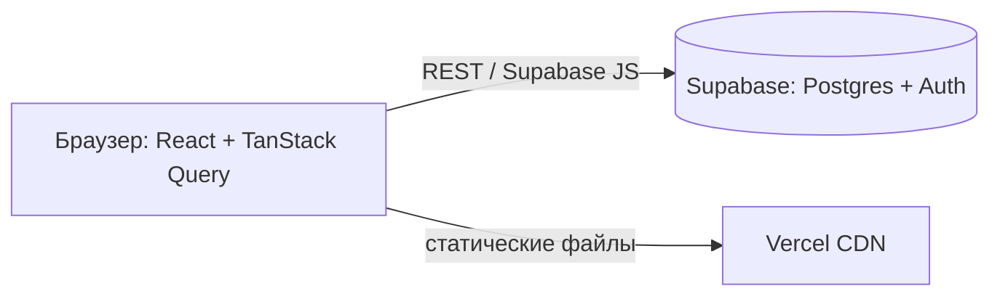

@@ 0

### На пальцах
Деплой — переезд проекта из твоей мастерской в магазин на главной улице. Vercel — аренда помещения с охраной (HTTPS) и уборкой (автоматические обновления). Переменные окружения — ключи от подсобки, которые хранятся у администратора, а не висят на витрине. Свой домен — вывеска с названием вместо номера дома.

### Как это работает
1. Импортируй репозиторий в Vercel: «Add New → Project».
2. Настройки сборки определятся сами для Vite и Next.js.
3. Environment Variables: добавь переменные отдельно для Production, Preview и Development. Секреты — только в серверные переменные (без префикса `VITE_` или `NEXT_PUBLIC_`).
4. Deploy. Каждый push в `main` — продакшен, каждая ветка и pull request — превью-адрес.

Свой домен:

1. Купи домен у регистратора (Reg.ru, Timeweb, Namecheap).
2. В Vercel: Settings → Domains → добавь `mysite.ru` и `www.mysite.ru`.
3. Vercel покажет, какие DNS-записи добавить у регистратора: обычно запись `A` на IP Vercel для корня и `CNAME` на `cname.vercel-dns.com` для `www`.
4. Через время (от минут до суток) DNS обновится, Vercel сам выпустит HTTPS-сертификат.

Откат: во вкладке Deployments можно одной кнопкой вернуть любую прошлую версию, если новая сломалась.

### Пример
```text
DNS-записи у регистратора для mysite.ru:

Тип     Имя    Значение
A       @      76.76.21.21
CNAME   www    cname.vercel-dns.com
```

```text
Environment Variables в Vercel:
NEXT_PUBLIC_SITE_URL = https://mysite.ru        (видна в браузере)
DATABASE_URL         = postgres://...           (только на сервере)
RESEND_API_KEY       = re_...                   (только на сервере)
```

### Частые ошибки
- Добавить переменную только для Production и удивляться, что превью не работает.
- Изменить переменную и не передеплоить — новые значения применяются при следующей сборке.
- Ждать, что домен заработает через минуту. DNS обновляется не сразу — проверяй через dnschecker.org.

### Мини-задание
Задеплой свой проект на Vercel, настрой переменные для Production и Preview, открой pull request и проверь превью. Если есть домен — подключи его и убедись, что работает HTTPS. Попробуй откатиться на прошлую версию через Deployments.

@@ 1

### На пальцах
Без обработки ошибок одна перегоревшая лампочка в подъезде обесточивает весь дом: упал один маленький виджет — и пользователь видит белый экран вместо всего сайта. Error boundary — автомат-предохранитель для отдельного участка: выбивает только его, а остальной дом продолжает работать.

### Как это работает
Уровни обработки ошибок во фронтенде:

1. **Запросы**: `try/catch` вокруг `fetch`, проверка `response.ok`, состояния ошибки в интерфейсе.
2. **Ошибки отрисовки**: если компонент упал при рендере, React размонтирует всё дерево — белый экран. Error boundary ловит такие ошибки в своём поддереве и показывает запасной интерфейс.
3. **Глобально**: логирование необработанных ошибок в сервис вроде Sentry.

Error boundary:

- В React это классовый компонент с `getDerivedStateFromError` и `componentDidCatch`. Удобнее взять готовую библиотеку `react-error-boundary`.
- Ставят на уровне приложения (последний рубеж) и вокруг независимых виджетов (график, комментарии, карта).
- Не ловит ошибки в обработчиках событий и асинхронном коде — там нужен обычный `try/catch`.
- В Next.js роль error boundary играет файл `error.tsx`.

### Пример
```tsx
import { ErrorBoundary } from "react-error-boundary";

function Fallback({ error, resetErrorBoundary }: { error: Error; resetErrorBoundary: () => void }) {
  return (
    <div role="alert" className="widget-error">
      <p>Не удалось показать блок.</p>
      <button onClick={resetErrorBoundary}>Попробовать снова</button>
    </div>
  );
}

export function Dashboard() {
  return (
    <main>
      <h1>Кабинет</h1>
      <ErrorBoundary FallbackComponent={Fallback}>
        <SalesChart />          {/* если упадёт — остальная страница работает */}
      </ErrorBoundary>
      <ErrorBoundary FallbackComponent={Fallback}>
        <LatestOrders />
      </ErrorBoundary>
    </main>
  );
}
```

```tsx
// корень приложения — последний рубеж
<ErrorBoundary fallback={<p>Что-то пошло не так. Обновите страницу.</p>}>
  <App />
</ErrorBoundary>
```

### Частые ошибки
- Ни одного error boundary — любая ошибка даёт белый экран.
- Ждать, что boundary поймает ошибку в `onClick` или `fetch`.
- Показывать пользователю стек вызовов вместо понятного текста.

### Мини-задание
Установи `react-error-boundary`, оберни два независимых блока своего кабинета. Сделай компонент, который бросает ошибку при нажатии кнопки «Сломать» (через состояние и `throw` в рендере), и убедись, что ломается только его блок.

@@ 2

### На пальцах
Работать прямо в `main` — ремонтировать машину на ходу, пока в ней едут пассажиры. Ветка — гараж: забираешь копию машины, спокойно чинишь, проверяешь. Pull request — заявка «посмотрите, что я сделал, можно возвращать машину в строй?». Code review — коллега-механик проверяет работу до того, как машина снова поедет.

### Как это работает
Рабочий цикл:

1. Обнови `main`: `git switch main && git pull`.
2. Создай ветку под задачу: `git switch -c feat/cart-counter`.
3. Работай, делай коммиты.
4. Отправь ветку: `git push -u origin feat/cart-counter`.
5. На GitHub — «Compare & pull request». Опиши: что сделано, зачем, как проверить, скриншоты.
6. Ревьюер оставляет комментарии к строкам. Ты исправляешь и пушишь в ту же ветку — PR обновится.
7. После одобрения — «Merge». Ветку можно удалить.

Хороший pull request:

- небольшой — до 300–400 строк, одна задача;
- с понятным заголовком и описанием;
- проходит автоматические проверки (линтер, тесты, сборка);
- со скриншотами, если менялся интерфейс.

Как ревьюить: проверяй логику и возможные ошибки, а не вкусовщину; предлагай, а не приказывай; хвали хорошие решения.

Конфликт слияния — когда две ветки поменяли одни и те же строки. Git покажет оба варианта между маркерами `<<<<<<<` и `>>>>>>>`, нужно оставить правильный и закоммитить.

### Пример
```bash
git switch main
git pull
git switch -c fix/mobile-menu
# ...правки...
git add .
git commit -m "fix: меню не закрывалось после перехода на iPhone"
git push -u origin fix/mobile-menu
```

```markdown
## Что сделано
Мобильное меню закрывается после клика по пункту и по клавише Esc.

## Как проверить
1. Открыть сайт на ширине 375px
2. Открыть меню, нажать «Услуги» — меню закрылось, страница прокрутилась

## Скриншоты
(до / после)
```

### Частые ошибки
- Огромный PR на 2000 строк «всё за неделю» — его невозможно нормально проверить.
- Коммитить прямо в `main` в командном проекте.
- Обижаться на замечания в ревью. Это про код, а не про тебя.

### Мини-задание
Даже в одиночном проекте сделай следующую фичу через ветку и pull request с описанием по шаблону. Включи в настройках репозитория защиту ветки `main`: запрет прямых push без PR.

@@ 3

### На пальцах
Conventional Commits — общий словарь для подписей в истории проекта. Как маркировка на продуктах: «молочное», «мясное», «овощи». Посмотрел на ярлык — и сразу понятно, что внутри, даже не открывая. А ещё по таким ярлыкам роботы могут автоматически собирать список изменений для новой версии.

### Как это работает
Формат: `тип(область): описание`

- **тип** — что за изменение;
- **область** (необязательно) — какая часть проекта: `cart`, `auth`, `api`;
- **описание** — кратко, в повелительном наклонении или прошедшем времени, по-русски или по-английски, как договорились в команде.

| Тип | Когда |
|---|---|
| `feat` | новая возможность для пользователя |
| `fix` | исправление ошибки |
| `refactor` | переделка кода без изменения поведения |
| `style` | форматирование, пробелы (не CSS-стили!) |
| `docs` | документация, README |
| `test` | тесты |
| `chore` | служебное: зависимости, конфиги |
| `perf` | ускорение |
| `ci` | настройки автоматических проверок |

Ломающее изменение помечают восклицательным знаком: `feat(api)!: убрать поле name` — или строкой `BREAKING CHANGE:` в теле коммита.

Инструменты: commitlint проверяет формат перед коммитом, release-please и semantic-release по истории сами определяют новую версию и пишут CHANGELOG.

### Пример
```text
feat(cart): показывать количество товаров в шапке
fix(auth): не выкидывать на вход при обновлении страницы
refactor(api): вынести запросы в отдельный модуль
docs: добавить раздел о переменных окружения в README
test(cart): проверить пересчёт суммы при удалении товара
chore: обновить vite до версии 6
perf(catalog): рисовать только видимые карточки
```

### Частые ошибки
- Писать `style:` для изменений CSS. `style` — это форматирование кода; новые стили интерфейса — `feat` или `fix`.
- Смешивать в одном коммите `feat` и `fix`.
- Описание общими словами: `fix: исправления`.

### Мини-задание
Перепиши последние 10 сообщений коммитов своего проекта в блокноте по формату Conventional Commits. Следующую неделю делай все коммиты только в этом формате.

@@ 4

### На пальцах
README с архитектурой — экскурсия по дому для нового жильца: где входная дверь, как устроены коммуникации, почему кухня здесь, а не там. Работодатель видит, что ты не просто «накодил», а понимаешь, как устроен твой проект и почему он устроен именно так.

### Как это работает
К обычному README (что это, демо, стек, запуск) добавь разделы:

1. **Архитектура** — схема: из каких частей состоит проект и как они общаются. Можно нарисовать в Mermaid — GitHub отображает такие схемы прямо в README.
2. **Структура папок** — где что лежит, коротко.
3. **Ключевые решения** — почему выбрал именно эти технологии и подходы: «TanStack Query — для кеша и обновления данных», «RLS — чтобы данные были защищены даже при прямом доступе к базе».
4. **Что можно улучшить** — честный список. Показывает, что ты видишь слабые места.
5. **Тесты и качество** — как запустить тесты, оценки Lighthouse.

### Пример
Схема архитектуры на Mermaid. В README её кладут в блок кода, у которого вместо языка указано слово mermaid, — GitHub нарисует картинку:



Остальные разделы:

```markdown
## Структура
- `src/features/notes` — список, форма и запросы заметок
- `src/features/auth` — вход, регистрация, RequireAuth
- `src/shared/ui` — кнопки, поля, модальные окна

## Решения
- **Supabase + RLS** — не нужен свой сервер, доступ к данным ограничен в самой базе
- **react-hook-form + zod** — одна схема для проверки и для типов формы
- **Оптимистичные обновления** — отметка «выполнено» меняется сразу, при ошибке откатывается

## Что улучшить
- Добавить офлайн-режим
- Покрыть e2e-тестами редактирование заметок
```

### Частые ошибки
- Описание архитектуры, скопированное из документации фреймворка.
- Схема, которая не совпадает с реальным кодом.
- Раздел «Решения» без объяснения «почему».

### Мини-задание
Добавь в README своего личного кабинета схему на Mermaid, структуру папок и три ключевых решения с объяснением. Проверь, что схема отображается на странице репозитория на GitHub.
