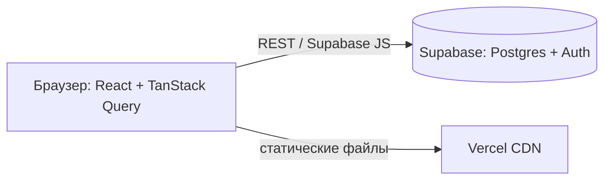

@@ 0

### Ситуация
Проект готов, но живёт по адресу `localhost:5173`. Отправить его в резюме нельзя, показать заказчику нельзя. А когда наконец задеплоишь, окажется, что форма не отправляется: на сервере нет переменной с ключом почтового сервиса. Деплой — не кнопка «загрузить файлы», а несколько решений, каждое из которых может сломать сайт.

### На пальцах
Деплой — переезд проекта из твоей мастерской в магазин на главной улице. Vercel — аренда помещения с охраной (HTTPS) и уборкой (автоматические обновления). Переменные окружения — ключи от подсобки, которые хранятся у администратора, а не висят на витрине. Свой домен — вывеска с названием вместо номера дома.

### Как это работает
>> Push в `main` → Vercel собирает → переменные окружения → свой домен → HTTPS

1. Импортируй репозиторий в Vercel: «Add New → Project».
2. Настройки сборки определятся сами для Vite и Next.js.
3. Environment Variables: добавь переменные отдельно для Production, Preview и Development. Секреты — только в серверные переменные (без префикса `VITE_` или `NEXT_PUBLIC_`).
4. Deploy. Каждый push в `main` — продакшен, каждая ветка и pull request — превью-адрес.

Свой домен:

1. Купи домен у регистратора (Reg.ru, Timeweb, Namecheap).
2. В Vercel: Settings → Domains → добавь `mysite.ru` и `www.mysite.ru`.
3. Vercel покажет, какие DNS-записи добавить у регистратора: обычно `A` на IP Vercel для корня и `CNAME` на `cname.vercel-dns.com` для `www`.
4. Через время (от минут до суток) DNS обновится, Vercel сам выпустит HTTPS-сертификат.

Откат: во вкладке Deployments можно одной кнопкой вернуть любую прошлую версию.

?: Почему изменённая переменная окружения не применяется, пока не сделаешь новый деплой? || Многие переменные встраиваются в код во время сборки — особенно публичные для браузера. Старая сборка уже содержит старые значения, поэтому нужно пересобрать проект.

### Пример
```text
Environment Variables в Vercel (только Production):
NEXT_PUBLIC_SITE_URL = https://mysite.ru
NEXT_PUBLIC_RESEND_API_KEY = re_...
DATABASE_URL = postgres://...
```

?! Найди две проблемы в этом наборе переменных. || Ключ почтового сервиса с префиксом `NEXT_PUBLIC_` попадёт в браузер, и любой сможет его украсть — нужен серверный `RESEND_API_KEY`. И переменные заданы только для Production: превью-деплои из pull request останутся без них и сломаются.

### Частые ошибки
- **Переменная только для Production** — превью не работает.
- **Переменную изменили, но не передеплоили.**
- **Ждать, что домен заработает через минуту.** DNS обновляется не сразу — проверяй через dnschecker.org.

### Проверь себя
?? Что происходит в Vercel при push в ветку, отличную от `main`? || Создаётся превью-деплой со своим адресом, а продакшен не меняется.
?? Какие DNS-записи обычно добавляют для домена на Vercel? || `A`-запись для корня домена на IP Vercel и `CNAME` для `www` на `cname.vercel-dns.com`.
?? Объясни своими словами, почему секретные ключи нельзя называть с префиксом `NEXT_PUBLIC_` или `VITE_`. || Такие переменные встраиваются в код для браузера, и любой посетитель может их увидеть в исходниках. Секреты должны быть доступны только серверу.

### Мини-задание
Задеплой свой проект на Vercel, настрой переменные для Production и Preview, открой pull request и проверь превью. Если есть домен — подключи его и убедись, что работает HTTPS. Попробуй откатиться на прошлую версию через Deployments.

@@ 1

### Ситуация
В кабинете клиента сломался маленький виджет с графиком продаж — сервер прислал данные в неожиданном формате. Казалось бы, мелочь. Но пользователь видит не «график недоступен», а абсолютно белый экран: исчезли меню, заказы, кнопка выхода. Одна ошибка в одном компоненте уронила всё приложение. Так React ведёт себя по умолчанию.

### На пальцах
Без обработки ошибок одна перегоревшая лампочка обесточивает весь дом: упал один маленький виджет — и пользователь видит белый экран вместо всего сайта. Error boundary — автомат-предохранитель для отдельного участка: выбивает только его, а остальной дом продолжает работать.

### Как это работает
>> Ошибка в компоненте → Error Boundary ловит → запасной экран вместо белой страницы

Уровни обработки ошибок во фронтенде:

1. **Запросы**: `try/catch` вокруг `fetch`, проверка `response.ok`, состояния ошибки в интерфейсе.
2. **Ошибки отрисовки**: если компонент упал при рендере, React размонтирует всё дерево — белый экран. Error boundary ловит такие ошибки в своём поддереве и показывает запасной интерфейс.
3. **Глобально**: логирование необработанных ошибок в сервис вроде Sentry.

Error boundary:

- В React это классовый компонент с `getDerivedStateFromError` и `componentDidCatch`. Удобнее взять готовую библиотеку `react-error-boundary`.
- Ставят на уровне приложения (последний рубеж) и вокруг независимых виджетов (график, комментарии, карта).
- Не ловит ошибки в обработчиках событий и асинхронном коде — там нужен обычный `try/catch`.
- В Next.js роль error boundary играет файл `error.tsx`.

?: Почему React без error boundary убирает с экрана всё приложение, а не только сломанный компонент? || React не знает, в каком состоянии остался интерфейс после ошибки, и показывать полусломанный экран считает опаснее — пользователь может увидеть неверные данные или нажать не туда. Error boundary — явное указание, что именно этот кусок можно безопасно заменить запасным.

### Пример
```tsx
import { ErrorBoundary } from "react-error-boundary";

export function Dashboard() {
  return (
    <main>
      <h1>Кабинет</h1>
      <ErrorBoundary fallback={<p role="alert">Не удалось показать график.</p>}>
        <SalesChart />
      </ErrorBoundary>
      <LatestOrders />
      <button onClick={() => { throw new Error("клик") }}>Сломать</button>
    </main>
  );
}
```

?! Что увидит пользователь, если упадёт `SalesChart` при отрисовке? А если ошибка случится в `LatestOrders`? А при нажатии «Сломать»? || При падении `SalesChart` — сообщение «Не удалось показать график», остальной кабинет работает. При падении `LatestOrders` — белый экран: его никто не оборачивает. Ошибку в `onClick` error boundary не ловит вовсе — её нужно обрабатывать `try/catch`.

### Частые ошибки
- **Ни одного error boundary** — любая ошибка даёт белый экран.
- **Ожидание, что boundary поймает ошибку в `onClick` или `fetch`.**
- **Стек вызовов пользователю** вместо понятного текста.

### Проверь себя
?? Какие ошибки ловит error boundary, а какие нет? || Ловит ошибки при отрисовке компонентов в своём поддереве. Не ловит ошибки в обработчиках событий и асинхронном коде.
?? Где обычно ставят error boundary? || На уровне всего приложения как последний рубеж и вокруг независимых виджетов.
?? Объясни своими словами, что такое error boundary. || Компонент-предохранитель: если что-то внутри него сломалось при отрисовке, он показывает запасной интерфейс, а остальное приложение продолжает работать.

### Мини-задание
Установи `react-error-boundary`, оберни два независимых блока своего кабинета. Сделай компонент, который бросает ошибку при нажатии кнопки «Сломать» (через состояние и `throw` в рендере), и убедись, что ломается только его блок.

@@ 2

### Ситуация
Ты первый день в команде. Коммитишь прямо в `main`, отправляешь — и через пять минут сайт лежит, потому что в твоём коде опечатка, а `main` автоматически деплоится. Коллеги в чате, мягко говоря, удивлены. В командах так не работают: изменения проходят через ветку, pull request и проверку коллегой.

### На пальцах
Работать прямо в `main` — ремонтировать машину на ходу, пока в ней едут пассажиры. Ветка — гараж: забираешь копию машины, спокойно чинишь, проверяешь. Pull request — заявка «посмотрите, что я сделал, можно возвращать машину в строй?». Code review — коллега-механик проверяет работу до того, как машина снова поедет.

### Как это работает
>> Ветка `feature/x` → коммиты → pull request → ревью → слияние в `main`

Рабочий цикл:

1. Обнови `main`: `git switch main && git pull`.
2. Создай ветку под задачу: `git switch -c feat/cart-counter`.
3. Работай, делай коммиты.
4. Отправь ветку: `git push -u origin feat/cart-counter`.
5. На GitHub — «Compare & pull request». Опиши: что сделано, зачем, как проверить, скриншоты.
6. Ревьюер оставляет комментарии к строкам. Ты исправляешь и пушишь в ту же ветку — PR обновится.
7. После одобрения — «Merge». Ветку можно удалить.

Хороший pull request:

- небольшой — до 300–400 строк, одна задача;
- с понятным заголовком и описанием;
- проходит автоматические проверки (линтер, тесты, сборка);
- со скриншотами, если менялся интерфейс.

Конфликт слияния — когда две ветки поменяли одни и те же строки. Git покажет оба варианта между маркерами `<<<<<<<` и `>>>>>>>`, нужно оставить правильный и закоммитить.

?: Почему маленький pull request лучше большого, даже если в сумме кода столько же? || Ревьюер может внимательно проверить 200 строк за 15 минут. 2000 строк он пролистает и одобрит, не вникая, — и ошибки пролезут. Маленький PR ещё и проще откатить, если что-то пошло не так.

### Пример
```bash
git switch main
git pull
git switch -c fix/mobile-menu
# ...правки...
git add .
git commit -m "fix: меню не закрывалось после перехода на iPhone"
git push -u origin fix/mobile-menu
```

?! Пока ты работал в своей ветке, коллега влил в `main` правку той же строки в том же файле. Что произойдёт при попытке слить твой PR? || GitHub сообщит о конфликте. Нужно подтянуть свежий `main` в свою ветку, открыть файл с маркерами `<<<<<<<` и `>>>>>>>`, оставить правильный вариант (или объединить оба), закоммитить и отправить.

### Частые ошибки
- **PR на 2000 строк «всё за неделю»** — нормально проверить невозможно.
- **Коммиты прямо в `main`** в командном проекте.
- **Обида на замечания в ревью.** Это про код, а не про тебя.

### Проверь себя
?? Какой командой создать новую ветку и сразу переключиться на неё? || `git switch -c имя-ветки`.
?? Что должно быть в описании хорошего pull request? || Что сделано и зачем, как проверить, скриншоты при изменении интерфейса.
?? Объясни своими словами, зачем нужен code review. || Чтобы второй человек проверил код до попадания в основную ветку: нашёл ошибки, предложил улучшения и узнал об изменениях, — и чтобы знания о проекте были не у одного человека.

### Мини-задание
Даже в одиночном проекте сделай следующую фичу через ветку и pull request с описанием. Включи в настройках репозитория защиту ветки `main`: запрет прямых push без PR.

@@ 3

### Ситуация
Перед релизом нужно собрать список изменений: что нового, что исправлено. Ты листаешь историю, а там «правки», «ещё фикс», «update», «wip». Час уходит, чтобы вспомнить, что значил каждый коммит. В командах, где историю пишут по единому формату, этот список собирает робот за секунду.

### На пальцах
Conventional Commits — общий словарь для подписей в истории проекта. Как маркировка на продуктах: «молочное», «мясное», «овощи». Посмотрел на ярлык — и сразу понятно, что внутри. А ещё по таким ярлыкам роботы могут автоматически собирать список изменений для новой версии.

### Как это работает
>> `feat:` новое → `fix:` исправление → `docs:` документация → `refactor:` без изменения поведения

Формат: `тип(область): описание`

- **тип** — что за изменение;
- **область** (необязательно) — какая часть проекта: `cart`, `auth`, `api`;
- **описание** — кратко, по договорённости в команде.

| Тип | Когда |
|---|---|
| `feat` | новая возможность для пользователя |
| `fix` | исправление ошибки |
| `refactor` | переделка кода без изменения поведения |
| `style` | форматирование, пробелы (не CSS-стили!) |
| `docs` | документация, README |
| `test` | тесты |
| `chore` | служебное: зависимости, конфиги |
| `perf` | ускорение |
| `ci` | настройки автоматических проверок |

Ломающее изменение помечают восклицательным знаком: `feat(api)!: убрать поле name` — или строкой `BREAKING CHANGE:` в теле коммита.

Инструменты: commitlint проверяет формат перед коммитом, release-please и semantic-release по истории сами определяют новую версию и пишут CHANGELOG.

?: Как по типам коммитов можно автоматически определить номер новой версии? || По соглашению: были только `fix` — увеличиваем последнюю цифру (1.4.2 → 1.4.3), был `feat` — среднюю (1.5.0), было ломающее изменение `!` — первую (2.0.0). Робот читает историю и считает сам.

### Пример
```text
feat(cart): показывать количество товаров в шапке
style(header): сделать кнопку синей
fix(auth): не выкидывать на вход при обновлении страницы
chore: обновить vite до версии 6
```

?! Какой из четырёх коммитов подписан неправильно и как его исправить? || `style(header): сделать кнопку синей`. `style` — только форматирование кода без изменения поведения. Новый цвет кнопки — видимое изменение интерфейса: это `feat(header)` или, если исправляли неверный цвет, `fix(header)`.

### Частые ошибки
- **`style:` для изменений CSS.** `style` — форматирование кода; новые стили интерфейса — `feat` или `fix`.
- **`feat` и `fix` в одном коммите.**
- **Описание общими словами:** `fix: исправления`.

### Проверь себя
?? Как выглядит формат Conventional Commits? || `тип(область): описание`, например `fix(cart): пересчитывать сумму при удалении товара`.
?? Как пометить ломающее изменение? || Восклицательным знаком после типа (`feat(api)!:`) или строкой `BREAKING CHANGE:` в теле коммита.
?? Объясни своими словами, чем `refactor` отличается от `fix`. || `fix` исправляет ошибку и меняет поведение программы. `refactor` переделывает код, но для пользователя всё работает точно так же, как раньше.

### Мини-задание
Перепиши последние 10 сообщений коммитов своего проекта в блокноте по формату Conventional Commits. Следующую неделю делай все коммиты только в этом формате.

@@ 4

### Ситуация
Работодатель открывает твой репозиторий. Видит README из шаблона Vite: «This template provides a minimal setup…». Закрывает вкладку. У соседнего кандидата README рассказывает, как устроен проект, почему выбраны эти технологии и что автор улучшил бы дальше. Даже если код похож, на собеседование позовут второго.

### На пальцах
README с архитектурой — экскурсия по дому для нового жильца: где входная дверь, как устроены коммуникации, почему кухня здесь, а не там. Работодатель видит, что ты не просто «накодил», а понимаешь, как устроен твой проект и почему.

### Как это работает
>> Что это → архитектура → как запустить → решения → что улучшить

К обычному README (что это, демо, стек, запуск) добавь разделы:

1. **Архитектура** — схема: из каких частей состоит проект и как они общаются. Можно нарисовать в Mermaid — GitHub отображает такие схемы прямо в README.
2. **Структура папок** — где что лежит, коротко.
3. **Ключевые решения** — почему выбрал именно эти технологии и подходы.
4. **Что можно улучшить** — честный список. Показывает, что ты видишь слабые места.
5. **Тесты и качество** — как запустить тесты, оценки Lighthouse.

?: Зачем в README раздел «Что можно улучшить» — разве это не показывает слабость? || Наоборот: так ты показываешь, что понимаешь ограничения своего решения и знаешь, куда расти. Это признак зрелого разработчика. А на собеседовании это готовая тема для разговора.

### Пример
Схема архитектуры на Mermaid (в README её кладут в блок кода с языком mermaid — GitHub нарисует картинку):



```markdown
## Решения
- **Supabase + RLS** — не нужен свой сервер, доступ к данным ограничен в самой базе
- **react-hook-form + zod** — одна схема для проверки и для типов формы
- **React** — популярный
```

?! Какой из трёх пунктов в разделе «Решения» не годится и как его переписать? || «React — популярный»: это не объясняет, почему он подходит именно этому проекту. Лучше: «React + TanStack Query — компонентный интерфейс и кеш серверных данных без ручных эффектов».

### Частые ошибки
- **Архитектура, скопированная из документации фреймворка.**
- **Схема, которая не совпадает с реальным кодом.**
- **Раздел «Решения» без объяснения «почему».**

### Проверь себя
?? Какие разделы стоит добавить в README кроме описания и инструкции запуска? || Архитектуру со схемой, структуру папок, ключевые решения с объяснениями, что можно улучшить, тесты и качество.
?? Как нарисовать схему, которую GitHub покажет прямо в README? || Описать её на языке Mermaid в блоке кода с указанием `mermaid`.
?? Объясни своими словами, чем хороший раздел «Решения» отличается от плохого. || В хорошем к каждой технологии написано, какую задачу проекта она решает и почему выбрана. В плохом — просто список модных названий.

### Мини-задание
Добавь в README своего проекта схему на Mermaid, структуру папок и три ключевых решения с объяснением. Проверь, что схема отображается на странице репозитория на GitHub.
